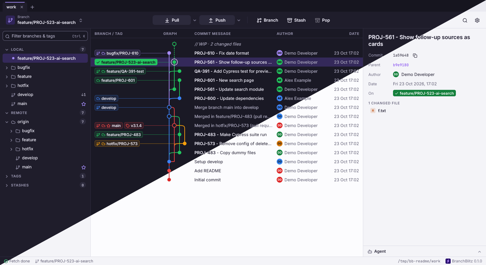

# BranchBlitz

A fast desktop git client written in Rust ([egui](https://github.com/emilk/egui)), built around one thing:
**always seeing every local branch, remote branch and tag in the commit graph, and merging them in two clicks.**
It has an AI agent built in that can operate the app for you, and you see every step it takes.



## Features

- **Commit graph** with coloured lanes and branch/tag labels. A local branch and its remote counterpart on
  the same commit share one label. Branch colours follow rules you set (git-flow names count as their role).
- **Sidebar** with local branches, remote branches per remote, worktrees, tags and stashes, grouped by
  folder (`feature/…`, `hotfix/…`), with ahead/behind counters and a filter (`Ctrl K`).
- **Right-click any branch** (sidebar or graph label): merge into the current branch, rebase, check out,
  fast-forward, create a branch or tag, rename, delete (locally or on the remote), push.
- **Right-click a commit**: branch or tag here, check out, cherry-pick, revert, reset (soft/mixed/hard).
- **Find commits** by message or hash (`Ctrl F`).
- **Fetch and pull**: fetch on opening and switching tabs, optional periodic auto-fetch; one Pull button
  whose default (fetch all, merge, fast-forward only, rebase) is remembered per repository.
- **Working copy**: stage, unstage, discard, diffs, commit and amend.
- **Merge conflicts resolved in the app**: per conflict block your version and the incoming one side by
  side, take mine / incoming / both, then save; correct during a rebase too, where git's "ours" and
  "theirs" swap.
- **Worktrees**: listed in the sidebar; switch, open in a new tab, remove (with the branch), lock. Checking out
  a branch that another worktree has shows that worktree instead.
- **Tabs** for multiple repositories, restored on start.
- **Themes**: light, dark or the system's, several accents, adjustable contrast and fonts. On
  [Omarchy](https://omarchy.org) the "Omarchy" theme uses the desktop's colours and follows when you switch.

All git work is done by the `git` binary itself, so SSH keys, credential helpers, hooks and your git config
behave exactly like in the terminal. Network operations never prompt in a terminal (`GIT_TERMINAL_PROMPT=0`);
use an SSH agent or a credential helper.

## Install

Download the package for your system from the [latest release](https://github.com/johandenhollander/branchblitz/releases/latest)
(about 7 to 10 MB). BranchBlitz needs `git` installed.

| System | Package | How |
|---|---|---|
| Debian, Ubuntu | `branchblitz_<version>_amd64.deb` / `_arm64.deb` | `sudo apt install ./branchblitz_*.deb` |
| Any Linux | `branchblitz-<version>-<arch>.AppImage` | `chmod +x` it and run it |
| Any Linux | `branchblitz-<version>-linux-<arch>.tar.gz` | unpack, run `./install.sh` (installs to `~/.local`) |
| macOS | `BranchBlitz-<version>-macos-<arch>.zip` | unzip, move BranchBlitz.app to Applications |
| Windows | `branchblitz-<version>-windows-x86_64.zip` | unzip, run `branchblitz.exe` |

The macOS and Windows builds are not signed. macOS: the first time, right-click BranchBlitz.app and choose
Open (or run `xattr -dr com.apple.quarantine BranchBlitz.app`). Windows: SmartScreen may ask; choose
"More info", "Run anyway". `SHA256SUMS` in the release lists the checksums.

From source (Rust 1.95 or newer):

```sh
cargo install --git https://github.com/johandenhollander/branchblitz
branchblitz                    # opens the repositories from last time
branchblitz ~/Projects/x       # opens (or focuses) a repository
```

On Linux, `scripts/install-desktop.sh` (from a clone) adds a desktop entry and the app icon, so app
launchers find it (also by typing `bb`).

### Platforms

BranchBlitz is developed and used on Linux (Wayland). macOS and Windows builds are checked in CI but have
seen little real use; reports are welcome. On Windows the agent can talk with you but cannot yet operate the
app (its tools use Unix sockets).

## The agent

The panel at the bottom right talks to an AI agent. Ask about the repository ("what changed in the last
commit?") or tell it what to do ("merge develop into this branch and take the incoming side for every
conflict"). It works in the open repository and you see every action happen in the app.

- Uses [Claude Code](https://docs.claude.com/en/docs/claude-code) when `claude` is on your `PATH`, with your
  own Claude Code login and settings. Other agent CLIs are planned.
- It reads files and operates BranchBlitz through the app's own tools: state, diffs, checkout, merge,
  rebase, branches, fetch/pull/push, stage and commit, stash, conflicts. It has no shell and cannot edit
  files directly.
- **Access** (lock button in the panel, or Settings, Agents): *Supervised* (default) asks you in a red bar
  before anything that publishes, rewrites or throws away work; *Auto* only asks before what throws work
  away; *Full access* never asks.
- Choose the model, show or hide its tool calls, and add your own standing instructions in Settings, Agents.

The agent reads repository content (files, diffs, commit messages), which can contain instructions meant to
mislead it. Keep *Supervised* for repositories you don't trust. A repository's own `.claude` settings are not
loaded.

## AI assistants outside the app (MCP)

`branchblitz mcp` starts a [Model Context Protocol](https://modelcontextprotocol.io) server on stdio. It runs
BranchBlitz without a window, so an assistant such as Claude can use the app the way you would: open a
repository, look at screenshots, right-click a branch and merge it, type a commit message. Your own settings
and open tabs are not touched.

```sh
claude mcp add --scope user branchblitz -- branchblitz mcp
```

Other clients (`claude_desktop_config.json` or equivalent):

```json
{ "mcpServers": { "branchblitz": { "command": "branchblitz", "args": ["mcp"] } } }
```

Tools: `open_repo`, `demo_repo` (throwaway repository under `/tmp`), `state`, `screenshot`, `widgets`,
`click`, `hover`, `type_text`, `key`, `scroll`, `resize`, `set_theme`, `wait_idle`.

The assistant runs real git commands on the repositories it opens, including pull, push and merges.
Destructive actions ask first in a red alert bar, whose button only works when the tool call passes
`confirm_dangerous: true`. That is a speed bump, not a lock: the real guard is your MCP client's approval
prompt. Opening a repository runs git in it, and a repository's own git config (for example
`core.fsmonitor`) can run programs, exactly as in a terminal: only open repositories you trust.

## Reporting bugs

Settings, About, **Report a bug** opens a GitHub issue with the version, system, rendering and git version
filled in. BranchBlitz logs failed operations and crashes (with a backtrace) to a log file, shown on the same
page; it can contain repository names and paths, so check what you share. After a crash, the next start
says so.

## Keyboard

- `↑` / `↓`: move through the commit list
- `Ctrl F`: find commits; `Ctrl K`: filter branches and tags
- `F5`: reload (e.g. after changing the repository outside the app)
- `Esc`: close the diff or the find bar
- Double-click a branch: check it out (a remote branch becomes a tracking local branch)

## Graphics

BranchBlitz renders on the integrated GPU where there are two (Settings, General, Graphics), so a laptop's
discrete GPU can stay asleep; choose *High performance* to use the discrete one. `WGPU_POWER_PREF` overrides
the setting. `BB_DEBUG_REPAINT=1` prints how often the window redraws (an idle window draws nothing).

## Development

```sh
cargo clippy --all-targets -- -D warnings
cargo test
scripts/demo-repo.sh && BB_DEMO=/tmp/bbdemo/work cargo test render -- --ignored --nocapture   # renders /tmp/bb-*.png
```

`scripts/readme-screenshot.sh` renders `docs/screenshot.png` (needs ImageMagick).
Release packages: `scripts/package-linux.sh` (.tar.gz, .deb via `cargo deb`, AppImage) and
`scripts/package-macos.sh <target>` write to `dist/`; `.github/workflows/release.yml` runs them for a `v*` tag
and creates a draft release.
`scripts/demo-repo.sh [dir]` builds a throwaway repository with a remote, branches, merges, a tag and
uncommitted changes (default `/tmp/bbdemo`). The render tests drive the real UI against it (the merge test
**merges `origin/develop` into the checked out branch**, so only point it at a throwaway repository).

In this repository `.mcp.json` registers the MCP server as `cargo run -- mcp`, so Claude Code uses the current
code. `AGENTS.md` describes the code layout and the conventions for AI-assisted work on it.

## License

Licensed under either of [Apache License, Version 2.0](LICENSE-APACHE) or [MIT license](LICENSE-MIT) at your
option. Bundled fonts keep their own licences: Inter and JetBrains Mono (SIL Open Font License) and Lucide
icons (ISC), in `assets/fonts/`.

Unless you explicitly state otherwise, any contribution you submit for inclusion in this work, as defined in
the Apache-2.0 license, shall be dual licensed as above, without any additional terms or conditions.
